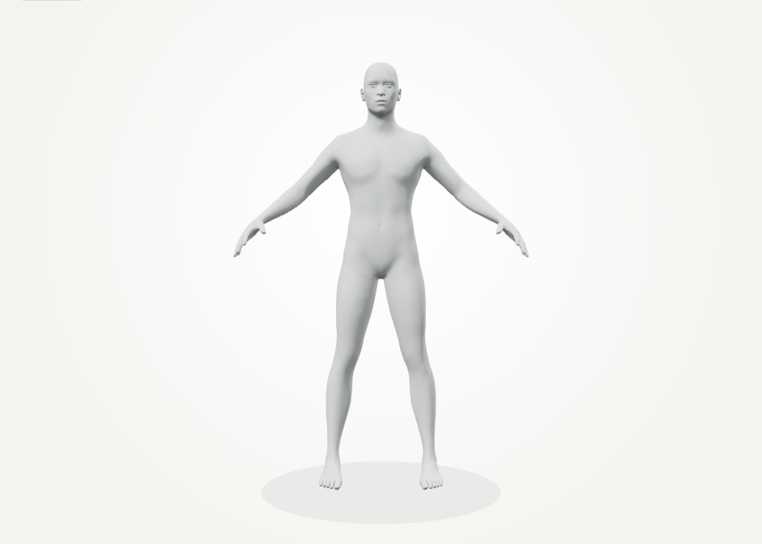
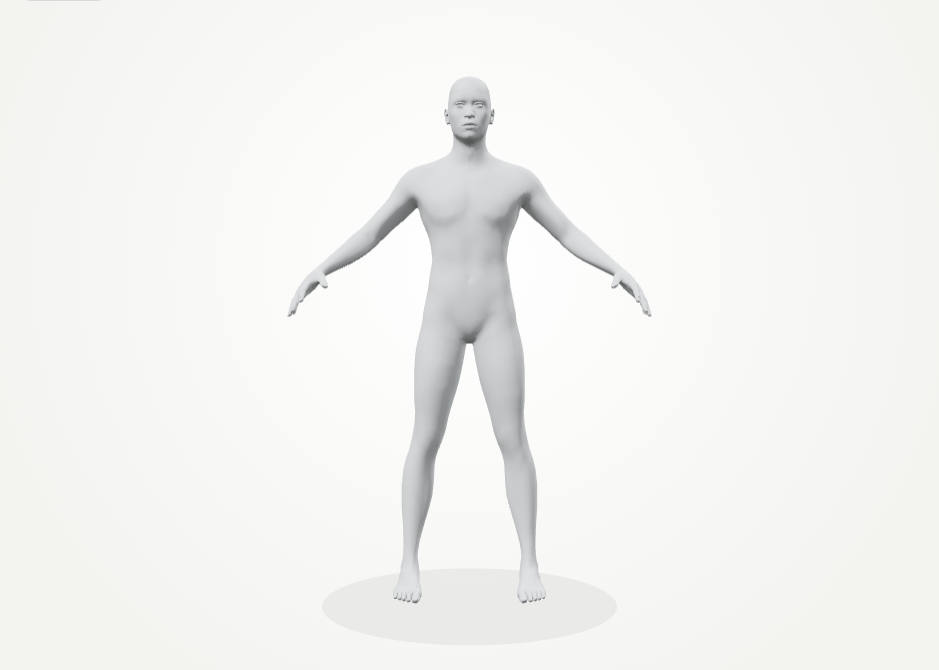
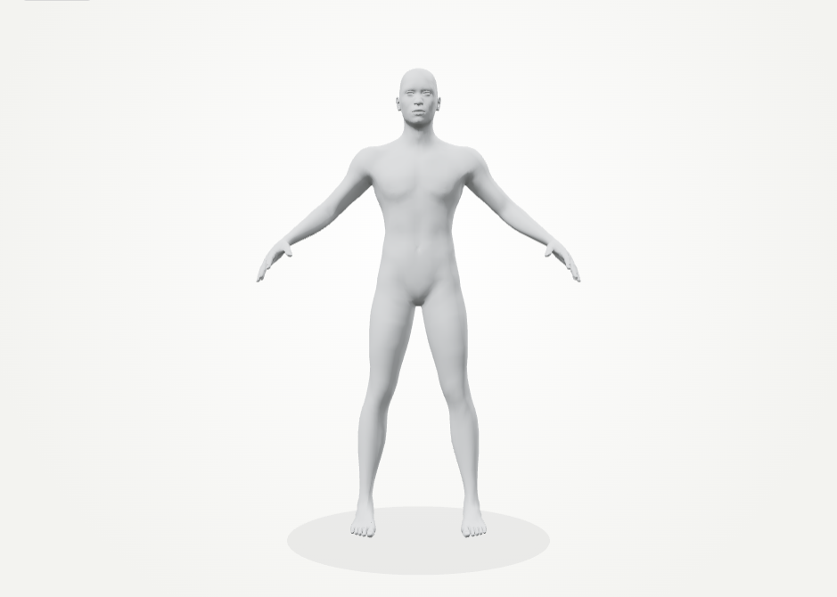
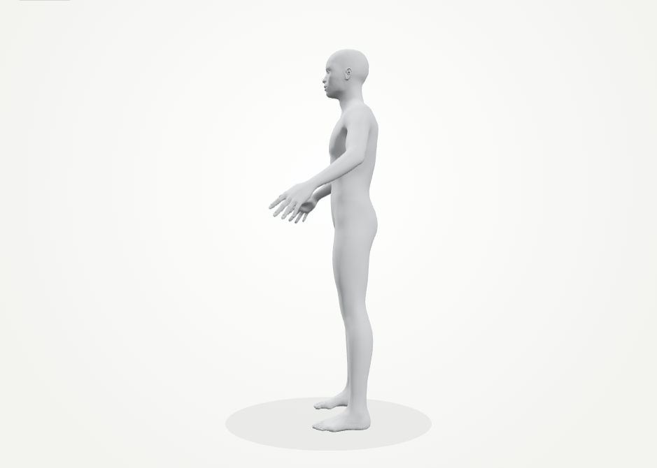
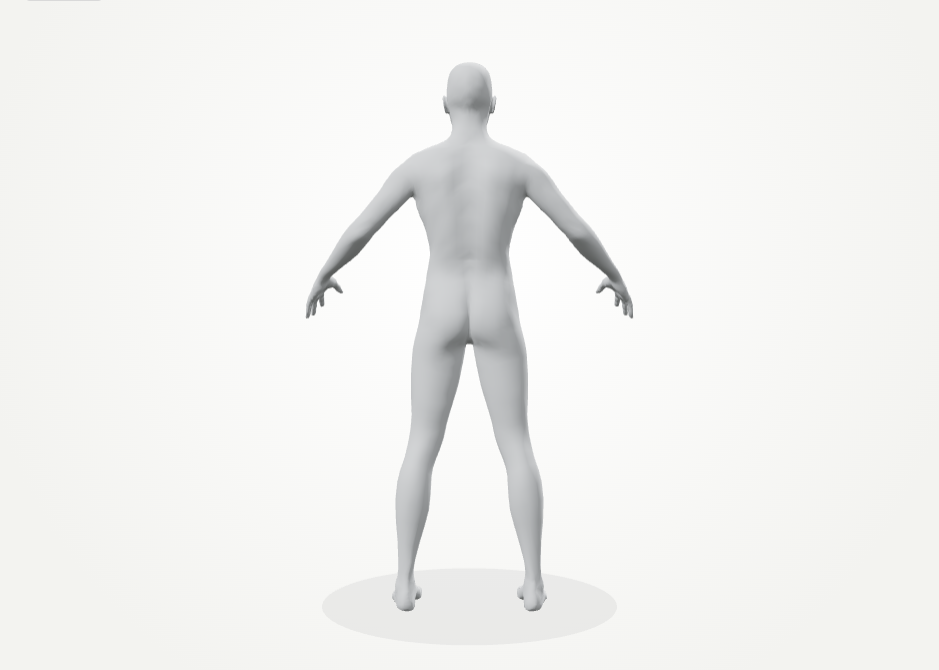
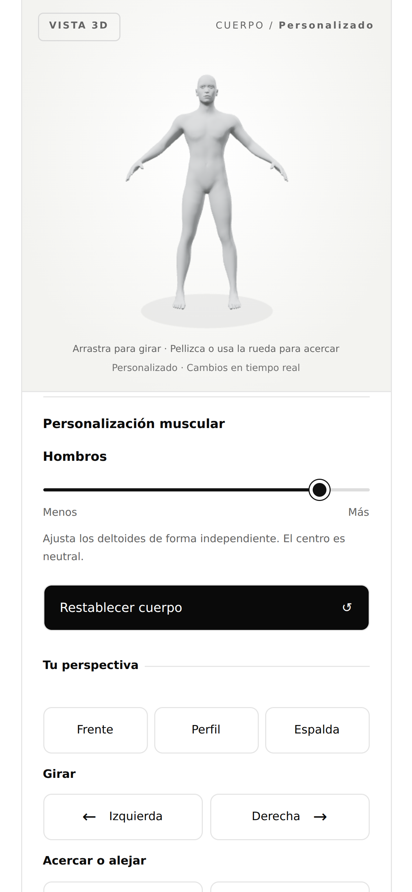

# GFIT 3D — Milestone 4: hombros independientes

**Entrega técnica del 5 de noviembre de 2026. Aprobado por Gabriel González el 20 de noviembre de 2026 para continuar la V1.** Rama exclusiva `gfit-3d-body-v1`, ChatGPT Work. Sin Claude, merge, cambios en main ni despliegue. M5 no iniciado.

## Aprobación del propietario (20 de noviembre de 2026)

Gabriel González aprobó M4 sobre la versión `47d24f3416409d9cccf253429ad132bfe6dbdcac`.

| Entorno | Estado | Evidencia |
| --- | --- | --- |
| Safari en iPhone 17 Pro Max, iOS 27.2 | Aprobado por el propietario | 25/25 comprobaciones visuales y funcionales satisfactorias. Gabriel no reportó problemas. |
| Chrome en Android físico | Pendiente de comprobar | Compatibilidad provisional apoyada en la cobertura automatizada. Puede comprobarse después con amigos o usuarios. |

Los resultados automatizados históricos se detallan en «Pruebas». La comprobación pendiente en Android no bloquea M5. Gabriel aprobó el alcance general de M5 por etapas. La autorización de implementación actual cubre únicamente el neutral femenino de M5.1.

## Probar

Descargar **GFIT-3D-Demo.html**, entregado con esta actualización, y abrir con doble clic en Chrome/Edge/Firefox moderno con WebGL 2. No requiere internet ni instalaciones. Seleccionar Atlético y mover **Personalización muscular → Hombros**; comparar Frente / Perfil / Espalda. Los presets conservan hombros. Restablecer cuerpo devuelve los tres sliders al centro; Restablecer vista solo cambia la cámara.

En iPhone la vista rápida de archivos puede no ejecutar HTML. Para probar en un teléfono de la misma Wi-Fi, servir la rama desde un computador:

```sh
git clone --branch gfit-3d-body-v1 --single-branch https://github.com/gabrielfitness/gabriel-fitness-landing.git gfit-3d-prueba
cd gfit-3d-prueba
python3 -m http.server 8000
```

Computador: `http://localhost:8000/modelo-3d.html`. Teléfono: `http://IP-LOCAL-DEL-COMPUTADOR:8000/modelo-3d.html`. Detener con Ctrl+C. No hay URL pública ni modificación de hosting.

## Preflight y preservación de M2

Base: `5d70371`. Se releyeron contexto, M1, M2, assets y últimos commits. Las pruebas existentes de geometría (121 combinaciones) y navegador pasaron antes de desarrollar M4. Main conserva `0e8f407989deb19f7157cf3f7b2d8f24b536f257`; landing, calculadora e imágenes idénticas.

`body-male-parametric.glb` sigue exactamente en SHA-256 `005b55f374e58b3f8d78c2184a38aeb520699c3f6fdff0bae0a2defe3eb0e327`. No se reconstruyó. El archivo M4 **body-male-shoulders.glb** copia todos sus buffers byte por byte, incluidos los ocho targets POSITION/NORMAL originales. Conserva 13,380 vértices, mismos IDs e índices, 26,756 triángulos. M1 y sus manifiestos tampoco cambiaron.

Con hombros 50, ambos targets nuevos pesan cero: los resultados M2/M3 se conservan exactamente. Con los tres controles en 50, vuelve el neutral original. No hay escalado del cuerpo/objeto ni desplazamiento de los brazos para simular hombros.

## Procedencia y método

Se inspeccionó el mismo commit MakeHuman `a8bc2d54ff0ac92e78ff71431b1023eda42bf482`. Sus modifiers definen **Shoulder muscle mass** por lado:

`makehuman/data/targets/armslegs/{l,r}-upperarm-shoulder-muscle-{decr,incr}.target`

Los cuatro archivos contienen aviso CC0. Fuente, autores, licencia y modificaciones: [THIRD_PARTY_ASSETS.md](../THIRD_PARTY_ASSETS.md). URLs y SHA-256 fijados: [manifiesto M4](../models/body-male-shoulders.source.json). El generador verifica los hashes incluso usando archivos locales. Los targets genéricos `measure-shoulder-dist` afectaban 4,524–4,718 vértices retenidos y fueron descartados.

Se combinan los lados izquierdo/derecho en dos morphs relativos `shoulders_decr` y `shoulders_incr`. Se usan los offsets artísticos originales sin modificarlos, filtrados por los IDs de M1 y convertidos de decímetros a metros. No fue necesario crear geometría propia, máscaras adicionales, morphs condicionados ni una cuadrícula nueva. La transición espacial procede del target oficial; no se recorta con una máscara artificial. La selección exacta de vértices y sus IDs originales está en el manifiesto.

| Target | Vértices desplazados | Vértices con normales ajustadas | Desplazamiento máximo |
| --- | ---: | ---: | ---: |
| Reducción bilateral | 100 (50 por lado) | 162 | 14.23 mm |
| Aumento bilateral | 326 (163 por lado) | 442 | 16.27 mm |

Las normales se calculan para la forma final de cada target y se codifican como deltas; solo se actualiza el vecindario de triángulos incidentes, evitando ruido de redondeo fuera de la región. Los deltas de posición son exactamente simétricos sobre X.

**Región:** cap lateral/anterior/posterior del deltoide y transición proximal hacia brazo y borde superior del torso. En coordenadas del neutral, aumento dentro de `|x| = 0.13045–0.311 m`, `y = 1.26889–1.44918 m`, `z = −0.06517–0.09465 m`; es un conjunto localizado de vértices, no toda esa caja. Reducción tiene una región más pequeña. Pecho/espalda reciben únicamente la transición adyacente del target; no se aumenta su masa global.

**Fuera de esa selección, desplazamiento exactamente cero:** cabeza, cuello, abdomen, cintura, pelvis, glúteos, piernas, antebrazos y manos. El brazo completo no se traslada ni se engrosa.

## Rango y composición

Hombros usa unidades visuales **0–100**, neutral **50**. Para `s = slider/100`:

- `decr = max(0, 1 − 2s)`;
- `incr = max(0, 2s − 1)`.

Se suma el delta localizado al resultado M2. Solo uno de los dos targets de hombros está activo; en neutral ninguno. Rango original 0–1, sin extrapolación. La transición es continua y lineal por cada mitad; ambas pendientes no tienen por qué coincidir en el centro porque son dos formas artísticas distintas. No hay salto de posición.

Grasa/músculo mantienen sus rangos y valores M2. Los presets solo animan esos dos parámetros, conservando hombros exactamente; cualquier slider cancela la animación en curso. Reset anima los tres hasta el neutral exacto. Respeta movimiento reducido y conserva render bajo demanda.

## Pruebas

- `verify-geometry.cjs`: preflight M2, 121 estados, 8 morphs y GLB original intacto.
- `verify-shoulders.cjs`: **54 estados**: 9 bases grasa×músculo con hombros 0/25/50/75/100 (45) + 3 presets con hombros 0/50/100 (9). Incluye los 27 estados exigidos.
- Comparación BVH de triángulos no adyacentes: **cero intersecciones nuevas**, cero triángulos colapsados. Continúan únicamente los ocho contactos internos de boca heredados de M1. Comprobación de finitud, buffers, IDs/índices, localización, simetría exacta de deltas y reproducción exacta de M2 con hombros neutrales.
- Barrido de 101 pasos de hombros sobre nueve bases: máximo desplazamiento por unidad **0.326 mm**, sin salto central. Khronos glTF Validator: **0 errores, 0 advertencias, 0 infos** para el GLB nuevo.
- `verify-3d.cjs`: geometría real en 27 combinaciones; fuera de la selección no se mueve ningún vértice; pesos M2 y sliders independientes; presets conservan hombros; cancelación, reset exacto, 360°, vistas, zoom/límite, ratón, teclado, tap de hombro, arrastre/pellizco móvil, responsive 320/390/768/1440, DPR, movimiento reducido, reposo sin render, recuperación 404/contexto y falta de WebGL. Landing y calculadora operativas. Cero errores JS/HTTP ni peticiones externas en uso normal del visor.
- El giro 360° verifica cámara con tolerancia `1e-10` e imagen con menos de 0.1% de píxeles diferentes; evita falsos fallos por redondeo/antialiasing al cerrar la vuelta.
- **Revisión visual:** 81 capturas (27 combinaciones × frente/perfil/espalda), más las nueve vistas comparables de Atlético. Sin roturas visibles en deltoides, axila, cuello, clavícula, brazo, pecho o espalda. El efecto es moderado; con grasa alta se aprecia menos definición.
- `verify-demo.cjs`: archivo `file://` abierto en Chromium con red desactivada, tres controles, presets, vistas, giro, zoom, teclado, reset exacto y responsive. Cero solicitudes HTTP/errores JS.
- Avisos de demo: texto en `<pre>` oculto escapando `&`, `<`, `>`; conserva `--source`, licencias y caracteres exactamente. Comparación completa de `textContent`; prueba adversarial con cierres HTML y `<script>` confirma que no se convierten en código ejecutable.

Reportes: [geometría](milestone-4-geometry.json), [navegador](milestone-4-browser.json), [offline](milestone-4-offline.json).

## Capturas comparables — Atlético

Misma cámara y encuadre por vista; solo cambia Hombros.

| Vista | Hombros bajos (0) | Neutral (50) | Hombros altos (100) |
| --- | --- | --- | --- |
| Frente |  |  |  |
| Perfil |  |  |  |
| Espalda |  |  |  |



## Tamaño, rendimiento y límites

GLB M4 **3,700,144 bytes**, frente a 3,056,784 de M2: **+643,360 bytes (+21.05%)**. Demo completa ~5.74 MB frente a ~4.87 MB anterior, principalmente por GLB en base64. La web solo carga el GLB M4, no descarga también M1/M2.

Dos slots de morph adicionales (10 en total); misma topología, material, draw calls y DPR≤1.5. La actualización sigue asignando pesos y deformando en GPU; sin recalcular vértices/normales en CPU en cada input. Los buffers de posición/normal adicionales ocupan ~642 KB; el almacenamiento GPU específico depende de Three.js/controlador. No se afirma consumo de memoria móvil medido.

En este entorno Chromium con WebGL de software, carga HTTP local alrededor de **0.3–0.5 s**; manejador + envío de render alrededor de **0.4 ms mediano**, con variación entre ejecuciones. La demo offline cargó alrededor de **0.9 s**. Los reportes contienen los valores finales. No son FPS ni latencia GPU de un teléfono; las diferencias con M2 no aíslan hardware/caché/carga del entorno.

La prueba física de Safari en iPhone se completó el 20 de noviembre. La de Android/Chrome sigue pendiente. Los 54 estados y la revisión visual no prueban matemáticamente todas las combinaciones continuas. Las normales son interpoladas, no recalculadas exactamente en cada combinación. Se conserva el maniquí/neutral M1 y sus contactos internos de boca. No es una medida clínica ni un modelo anatómicamente certificado; grasa alta atenúa la definición del hombro. No se extrapola el rango para obtener hipertrofia extrema.

## Reproducir

Dependencias solo de desarrollo, sin cambios a la arquitectura estática:

```sh
npm install --prefix /tmp/gfit-qa playwright pngjs three@0.180.0 three-mesh-bvh gltf-validator esbuild
/tmp/gfit-qa/node_modules/.bin/playwright install chromium
NODE_PATH=/tmp/gfit-qa/node_modules node tools/verify-geometry.cjs
NODE_PATH=/tmp/gfit-qa/node_modules node tools/verify-shoulders.cjs
NODE_PATH=/tmp/gfit-qa/node_modules node tools/verify-3d.cjs
NODE_PATH=/tmp/gfit-qa/node_modules node tools/export-demo.cjs /tmp/GFIT-3D-Demo.html
NODE_PATH=/tmp/gfit-qa/node_modules node tools/verify-demo.cjs /tmp/GFIT-3D-Demo.html
```

Opcional `CHROMIUM_EXECUTABLE=/ruta/a/chromium`. `GFIT_REVIEW_DIR=/ruta/temporal` genera las 81 vistas de extremos durante la prueba de navegador. El generador `python3 tools/build-shoulders.py --source /ruta/a/makehuman` usa el checkout fijado, o descarga solo los cuatro targets al omitir `--source`; exige el hash exacto de M2.

## Decisiones para siguientes músculos y M5

Mantener un target localizado con centro cero, selección/IDs auditables, prueba del cuerpo M2 intacto y matriz de combinaciones por cada músculo futuro. No reutilizar este rango, máscara o distribución de hombros automáticamente para pecho/brazos/piernas; si aparecen cruces, reducir amplitud o añadir correcciones condicionadas después de revisar la causa.

**Recomendación para M5:** después de la revisión de Gabriel y una prueba en teléfonos físicos, retomar Hombre/Mujer según el plan original. Validar la base femenina y sus propios targets globales/localizados; no asumir que estos offsets masculinos tienen igual calidad sobre otra base. No se inició modelo femenino, otros músculos, meses, cuentas, fotos, medidas ni anatomía interna.
